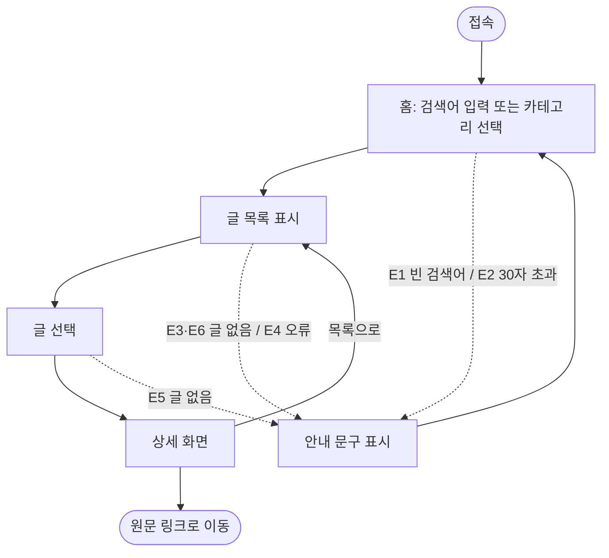

# PRD_everyThing

> 서비스 이름: **everyThing** (별칭: 띵지대의 모든 것)
> 흩어진 명지대 게시글과 꿀팁을 한곳에 모아 검색하고 확인하는 읽기 전용 웹사이트
> 버전: v0.1 (MVP)

---

## 1. 프로젝트 개요

### 해결하려는 문제
명지대 관련 정보(학사 공지, 장학 안내, 학식·식당, 공모전·해커톤, 동아리 홍보, 생활 꿀팁)가 학교 홈페이지, 커뮤니티, 단톡방, SNS 등에 흩어져 있다. 학교 홈페이지에서는 공식 공지를 통합해 검색할 수 있지만, 커뮤니티 글, 동아리 홍보 글, 생활 꿀팁은 포함되지 않아 따로 찾아야 한다. 필요한 정보를 찾으려면 여러 곳을 돌며 검색해야 하고, 최신 글인지 알기도 어렵다.

**기존 방식의 한계**
- 학교 홈페이지의 정보는 긴 PDF 문서가 많아, 학생이 필요한 내용을 직접 뽑아내야 한다. (예: 수강신청 안내)
- 학생들이 정리한 꿀팁은 커뮤니티(에브리타임 등)에 올라와 학교 홈페이지에서 검색되지 않는다. (예: 흡연장 위치 설명, 수강신청 팁, 교수님께 보내는 증원 메일 양식)
- 동아리 홍보 글도 대부분 개인이 커뮤니티에 올려, 학생은 두 곳을 따로 확인해야 한다.

**everyThing의 차이**
- 공식 문서는 운영자가 핵심만 요약해 올리고, 학생이 정리한 꿀팁과 함께 한곳에서 검색할 수 있게 한다.
- 모든 글에 원문 링크를 달아 원본도 확인할 수 있게 한다.

### 왜 중요한가
- 정보를 놓치면 장학·공모전 신청 기한 같은 실질적 손해로 이어진다.
- 신입생·복학생은 어디서 무엇을 찾아야 하는지 모르는 경우가 많다.
- 꿀팁이 일회성 글로 묻혀 같은 질문이 반복된다.
- **사회적 시사점:** 정보가 흩어져 있으면 선배·지인이 있는 학생은 쉽게 얻지만, 신입생·복학생·편입생처럼 연결이 적은 학생은 놓치기 쉬워 정보 접근 격차가 생긴다. 한곳에서 검색할 수 있게 하면 이 격차를 줄일 수 있다.

### 목적
- 흩어진 글을 한곳에 모아 **검색 한 번으로** 원하는 글을 찾게 한다.
- 카테고리별로 훑어보며 놓친 정보를 발견하게 한다.
- 공식 문서는 요약본으로 제공해 핵심 정보만 빠르게 읽게 한다.

### 한 줄 정의
**명지대 학생이 "이거 어디서 봤더라?"를 10초 안에 해결하는 교내 정보 모음 검색 사이트.**

---

## 2. 주요 타겟 (대표 사용자 1명)

| 항목 | 내용 |
|---|---|
| 이름(가상) | 김하늘 |
| 신분 | 명지대 2학년 (복학 직후) |
| 사용 상황 | 공강 시간, 이동 중 지하철·버스 안에서 급하게 정보 확인 |
| 사용 기기 | 스마트폰(주), 노트북(보조) |
| 현재 해결 방식 | 학교 홈페이지 → 커뮤니티 검색 → 선배·친구에게 카톡 질문 순으로 찾음. 평균 10분 이상 소요 |
| 회원가입 | **매우 귀찮아함.** 가입이 필요하면 바로 이탈함 → 로그인 없이 사용 가능해야 함 |

---

## 3. 핵심 기능 (MVP)

| 우선순위 | 기능 | 완료 기준 |
|---|---|---|
| 1 | 키워드 검색 | 검색어를 입력하면 제목·본문·태그 규칙에 맞는 글 목록이 최신순으로 표시되고, 없으면 안내 문구가 표시된다 |
| 2 | 카테고리별 목록 보기 | 카테고리를 누르면 해당 카테고리의 글만 최신순으로 표시된다 |
| 3 | 게시글 상세 보기 | 글을 누르면 제목·본문·작성일·태그·원문 링크(사진이 있으면 사진)가 한 화면에 표시된다 |

### 검색 규칙
- **제목·본문:** 검색어가 포함되면 결과에 포함 (부분 일치, 대소문자 구분 없음)
- **태그:** 검색어와 완전히 일치할 때만 결과에 포함. 본문에 없는 유사 표현도 태그로 찾을 수 있게 하되(예: 태그 `#식단표`가 있으면 '식단표' 검색 시 노출), 부분 일치로 관련 없는 글이 섞이는 것을 줄이기 위함
- **정렬:** 최신순 고정 (사용자가 바꿀 수 없음)
- **더 보기:** 한 번에 10건 표시, [더 보기] 버튼으로 10건씩 추가

### 카테고리 (확장 가능)
학사 / 장학 / 식당(#식단표) / 공모전·해커톤(#교내행사) / 동아리 / 꿀팁
→ 이후 카테고리 추가를 고려해 목록은 데이터로 관리하고, 화면은 카테고리 개수에 영향받지 않게 한다.

### 없어도 되는 기능 (이번 MVP에서 제외 판단)
- 최근 본 글, 조회수 표시, 검색어 자동완성

---

## 4. 사용자 흐름 (User Flow)

사용자는 방문자 1종류뿐이다(로그인 없음).

### 번호형 흐름
1. 사용자가 사이트에 접속한다.
2. 홈 화면에서 상단바의 카테고리 메뉴와 검색창을 확인한다.
3. 검색창에 검색어를 입력한다. (카테고리로 찾을 때는 이 단계를 건너뛴다.)
4. [검색] 버튼을 누른다. (카테고리로 찾을 때는 상단바 카테고리 메뉴에서 항목 하나를 누른다.)
5. 시스템이 조건에 맞는 글 목록을 최신순으로 보여준다.
6. 더 많은 글이 필요하면 [더 보기]를 누른다.
7. 글 하나를 누른다.
8. 상세 화면에서 본문을 읽는다.
9. 필요하면 [원문 보기] 링크를 누른다.
10. [← 목록] 버튼을 눌러 이전 목록으로 돌아간다.

### 예외 상황
- **E1.** 검색어를 입력하지 않고 검색을 누르면 안내 문구를 표시하고 목록은 바뀌지 않는다.
- **E2.** 검색어가 30자를 초과하면 안내 문구를 표시하고 목록은 바뀌지 않는다.
- **E3.** 검색 결과가 0건이면 '글이 없다'는 안내 문구를 표시한다.
- **E4.** 데이터를 불러오지 못하면 오류 문구와 [다시 시도] 버튼을 표시한다.
- **E5.** 존재하지 않는 글 주소로 접속하면 '글을 찾을 수 없음' 화면과 [홈으로] 버튼을 표시한다.
- **E6.** 카테고리에 등록된 글이 없으면 '아직 등록된 글이 없다'는 문구를 표시한다.

### 순서도 (Mermaid)

---

## 5. 입력과 출력 (화면별)

데이터는 **GET 방식으로 조회만** 한다. (예: `GET /posts?q=키워드&category=장학&page=1`, `GET /posts/{id}`)

### 화면 1. 홈

| 구분 | 내용 |
|---|---|
| 입력 | 검색어(텍스트, 1~30자, 앞뒤 공백 제거) / 카테고리 선택(전체 + 6개 중 1개) |
| 처리 | 검색어 또는 카테고리를 조건으로 글 목록을 GET 조회. 조건이 없으면 최신 글 10건 조회 |
| 출력 | 상단바(왼쪽에 서비스명 'everyThing', 그 옆에 카테고리 메뉴를 가로로 나열하고 선택된 항목은 네이비 강조, 모바일에서는 가로 스크롤), 검색창(안내문구 '궁금한 명지대 정보를 검색해 보세요'), 네이비 [검색] 버튼, 최신 글 카드 10건(제목·카테고리·작성일), [더 보기] 버튼 |
| 오류 | 빈 값: '검색어를 입력해 주세요.' / 30자 초과: '검색어는 30자까지 입력할 수 있어요.' / 로딩 실패: '정보를 불러오지 못했어요.' + [다시 시도] 버튼 |

### 화면 2. 검색·카테고리 결과 목록

| 구분 | 내용 |
|---|---|
| 입력 | 검색어(텍스트, 1~30자) 또는 카테고리(6개 중 1개) / [더 보기] 클릭 / 글 카드 클릭 |
| 처리 | 검색 규칙에 맞는 글을 최신순으로 조회, 10건씩 추가 조회 |
| 출력 | 상단 '"검색어" 검색 결과 N건'(또는 카테고리명), 글 카드(제목, 본문 앞 50자 미리보기, 카테고리 뱃지, 태그, 작성일), 검색어 일치 단어 노란색 강조, 남은 글이 있을 때만 [더 보기] 버튼 |
| 오류 | 검색 결과 0건: '검색 결과가 없어요. 다른 키워드로 검색하거나 카테고리를 선택해 보세요.' / 카테고리 글 0건: '아직 등록된 글이 없어요.' / 로딩 실패: '정보를 불러오지 못했어요.' + [다시 시도] 버튼 |

### 화면 3. 게시글 상세

| 구분 | 내용 |
|---|---|
| 입력 | 글 번호(주소의 id, 1 이상의 정수) / [원문 보기] 클릭 / [← 목록] 클릭 |
| 처리 | 글 번호로 글 1건을 GET 조회 |
| 출력 | 제목(큰 글씨), 카테고리 뱃지, 작성일, 태그(#식단표 형태), 이미지(있을 때만 표시, 없으면 영역 숨김), 본문 전체, 네이비 [원문 보기] 버튼(새 탭), 회색 [← 목록] 버튼 |
| 오류 | 글 없음: '글을 찾을 수 없어요. 삭제되었거나 주소가 잘못되었을 수 있어요.' + [홈으로] 버튼 / 로딩 실패: '정보를 불러오지 못했어요.' + [다시 시도] 버튼 |

### 데이터 형식 (게시글 1건)

| 필드 | 형식 | 비고 |
|---|---|---|
| id | 숫자 | 고유 번호 |
| title | 문자열 | 최대 100자 |
| category | 문자열 | 학사 / 장학 / 식당 / 공모전·해커톤 / 동아리 / 꿀팁 (추가 가능) |
| tags | 문자열 배열 | 글당 최대 5개, 태그당 1~10자 |
| content | 문자열 | 본문 (공식 문서는 운영자가 작성한 요약본) |
| imageUrl | 문자열 | 선택(없을 수 있음) |
| url | 문자열 | 원문 주소 |
| createdAt | 날짜 | YYYY-MM-DD |

### 데이터 수집 방식
- 크롤링 또는 직접 검수 후 복사한 글을 **미리 정리해 둔 데이터(JSON)** 로 사용한다. 단, 학교 인증이 필요한 커뮤니티 글은 자동 수집하지 않고 허락받을 수 있는 출처만 사용한다(부록 A 참고).
- 학교 공식 문서(PDF 등)는 운영자가 AI 등을 활용해 핵심만 요약한 뒤 `content`에 넣는다. 요약은 사용자가 쓰는 기능이 아니라 운영자의 데이터 준비 단계이며, 사용자는 요약본을 읽고 원본은 원문 링크로 확인한다.
- 사이트 실행 중 실시간 수집은 하지 않는다.
- 모든 글에 원문 링크를 반드시 표기한다.

---

## 6. 제외 범위 (Out of Scope)

AI가 임의로 덧붙이기 쉬운 기능을 우선 포함했다.

| 번호 | 제외 기능 | 구분 |
|---|---|---|
| 1 | 로그인 / 회원가입 | 제외 |
| 2 | 데이터 변경 기능 (글쓰기·수정·삭제 등, 모두 POST 계열 요청) | 2차 버전 후보 |
| 3 | 지도 기능 (흡연장 위치, 상권 추천 등, 지도 API 사용) | 2차 버전 후보 |
| 4 | 실행 중 외부 사이트 실시간 수집·연동 및 AI 요약 자동화 (크롤링, 요약 연동 등) | 2차 버전 후보 |
| 5 | 사용자 참여 기능 (좋아요, 댓글, 북마크 등) | 제외 |
| 6 | 알림 (푸시, 이메일, 카카오톡 등) | 제외 |
| 7 | 화면 표시 설정 변경 (정렬 옵션 변경, 다크/라이트 모드 전환 등) | 제외 |
| 8 | 학사 일정 캘린더 (강의평가, 등록금 납입, 중간고사 기간 등) | 2차 버전 후보 |

---

## 부록 A. 열린 이슈

| 이슈 | 현재 입장 | 확인 방법 |
|---|---|---|
| 게시글 수집·게시의 저작권 및 이용 약관 문제 | 출처와 원문 링크를 반드시 표기. 사용 범위는 확인 전까지 단정하지 않음 | 총학생회 등 관련 기관에 문의. 개인이 쓴 커뮤니티 글은 특히 별도 확인 |
| 동아리 글의 출처 (커뮤니티 글은 학교 인증이 필요하고 이용 약관 확인이 필요함) | 커뮤니티 글 자동 수집은 하지 않음. 동아리 공식 홍보물 등 허락받을 수 있는 출처를 우선 사용 | 이용 약관 확인, 동아리연합회·총학 등에 문의 |

## 부록 B. PRD 점검표

- [x] 문제를 한 문장으로 말할 수 있는가 → 흩어진 교내 정보를 찾는 데 시간이 오래 걸린다.
- [x] 사용자를 특정 인물로 적었는가 → 2학년 복학생 김하늘
- [x] MVP 기능이 3개 이하인가 → 검색 / 카테고리 목록 / 상세 보기 (3개)
- [x] 모든 화면에 입력과 출력이 있는가 → 3개 화면 모두 작성
- [x] 제외 범위가 3개 이상인가 → 8개
